# NEWS X PAPER — Modern Digital News Portal

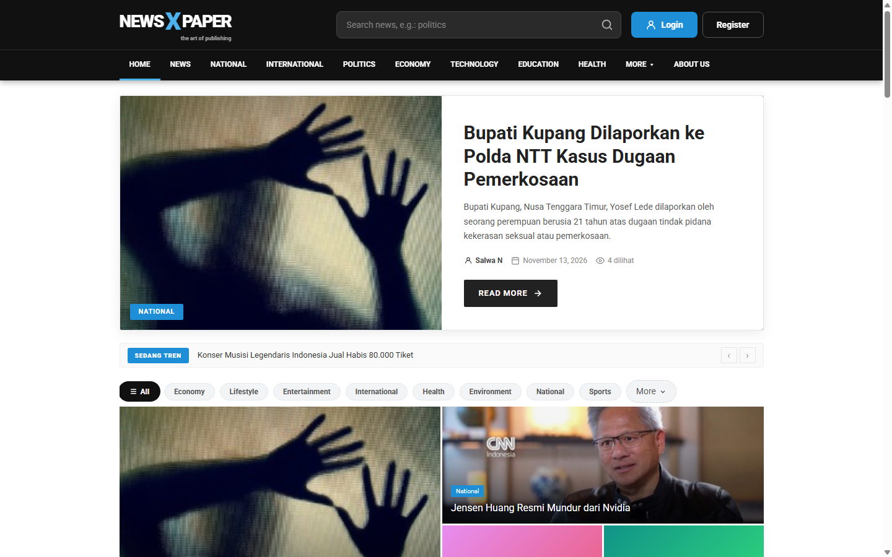

<p align="center">
  <strong>Platform Portal Berita Digital Indonesia dengan Sentuhan Editorial Klasik Modern</strong><br>
  <em>"The Art of Modern Digital Publishing"</em>
</p>

<p align="center">
  <a href="#-teknologi-yang-digunakan"></a>
  <a href="#-teknologi-yang-digunakan"></a>
  <a href="#-teknologi-yang-digunakan"></a>
  <a href="#-teknologi-yang-digunakan"></a>
  <a href="#-teknologi-yang-digunakan"></a>
  <a href="#-lisensi"></a>
</p>

---

## 📑 Daftar Isi

- [1. Judul dan Identitas Project](#1-judul-dan-identitas-project)
- [2. Deskripsi NewsXPaper](#2-deskripsi-newsxpaper)
- [3. Gambaran Umum Project](#3-gambaran-umum-project)
- [4. Preview Website](#4-preview-website)
- [5. Galeri Screenshot](#5-galeri-screenshot)
  - [Halaman Publik](#halaman-publik)
  - [Autentikasi](#autentikasi)
  - [Dashboard Admin](#dashboard-admin)
  - [Profil dan Mobile](#profil-dan-mobile)
- [6. Fitur Utama](#6-fitur-utama)
- [7. Teknologi yang Digunakan](#7-teknologi-yang-digunakan)
- [8. Arsitektur Project](#8-arsitektur-project)
- [9. Persyaratan Instalasi](#9-persyaratan-instalasi)
- [10. Panduan Instalasi](#10-panduan-instalasi)
- [11. Konfigurasi Environment](#11-konfigurasi-environment)
- [12. Konfigurasi Database](#12-konfigurasi-database)
- [13. Struktur Folder Project](#13-struktur-folder-project)
- [14. Hak Akses Pengguna](#14-hak-akses-pengguna)
- [15. Informasi Keamanan](#15-informasi-keamanan)
- [16. Informasi Deployment](#16-informasi-deployment)
- [17. Panduan Mengatasi Masalah](#17-panduan-mengatasi-masalah)
- [18. Pengembangan Selanjutnya](#18-pengembangan-selanjutnya)
- [19. Lisensi](#19-lisensi)
- [20. Kredit dan Pengembang](#20-kredit-dan-pengembang)

---

## 1. Judul dan Identitas Project

| Informasi | Keterangan |
| :--- | :--- |
| **Nama Aplikasi** | **NEWS X PAPER** |
| **Slogan** | *"The Art of Modern Digital Publishing"* |
| **Tipe Aplikasi** | Content Management System (CMS) & Portal Berita Digital |
| **Framework Utama** | Laravel 13.33.0 |
| **Bahasa Utama** | PHP 8.3+ / 8.5.x & JavaScript (ESModules) |
| **Basis Data** | MySQL / MariaDB (Mendukung UTF8MB4) |
| **Arsitektur Tampilan** | Responsive Desktop & Mobile-first |
| **Repository GitHub** | [https://github.com/najwapuspa/portal-berita](https://github.com/najwapuspa/portal-berita) |

---

## 2. Deskripsi NewsXPaper

**NEWS X PAPER** adalah platform portal berita berbasis web mutakhir yang memadukan keindahan tipografi editorial surat kabar klasik dengan keandalan teknologi web modern. Portal ini dirancang untuk menyajikan informasi terkini dari berbagai penjuru tanah air dan dunia dengan tata letak yang bersih, navigasi yang intuitif, serta performa pemuatan yang cepat dan efisien.

Selain menyediakan antarmuka membaca yang nyaman bagi pembaca publik, NewsXPaper dilengkapi dengan sistem agregasi berita pintar berbasis **RSS Feed Engine** yang mampu mengumpulkan dan memperbarui ratusan artikel harian secara otomatis dari media terpercaya nasional (CNN Indonesia, ANTARA, Republika, CNBC Indonesia, Tempo, dan Sindonews) dengan algoritma deduplikasi tautan cerdas.

Bagi pengelola redaksi, NewsXPaper menyediakan panel administrasi komprehensif untuk mengelola artikel, menyusun kategori berita, memoderasi interaksi komentar pembaca, memantau analitik trafik, hingga mencetak dan mengekspor laporan statistik dalam format PDF dan Excel.

---

## 3. Gambaran Umum Project

NewsXPaper dibangun sebagai solusi portal informasi digital yang mandiri, scalable, dan aman. Proyek ini memadukan kemudahan pemeliharaan konten manual dengan otomatisasi pengumpulan informasi berskala luas.

### Sorotan Metrik Project:
- **870+ Artikel Aktif**: Terintegrasi ke dalam basis data produksi lokal dan siap dikonsumsi.
- **12 Kategori Berita Terstruktur**: Meliputi Politik, Ekonomi, Olahraga, Teknologi, Opini, Nasional, Internasional, Pendidikan, Kesehatan, Hiburan, Gaya Hidup, dan Lingkungan.
- **Sistem Peran Ganda (Dual Role)**: Pemisahan hak akses antara Administrator Redaksi dan Pengguna Terdaftar (Pembaca).
- **Mesin Ekspor Multi-Format**: Kemampuan menyusun berkas laporan ringkasan eksekutif berstandar cetak A4 (PDF) dan berkas analitik tabular multi-sheet (Excel).
- **Performa Responsif**: Dioptimalkan untuk render cepat pada layar resolusi tinggi desktop (1440px+) hingga smartphone modern (390px).

---

## 4. Preview Website

Sistem menyajikan estetika monokromatis dan aksen editorial yang elegan:

```
+-----------------------------------------------------------------------------------+
|  [ TOP BAR: TANGGAL | RUNNING TICKER BREAKING NEWS | PENCARIAN | LOGIN / DAFTAR ] |
+-----------------------------------------------------------------------------------+
|                            N E W S   X   P A P E R                                |
|                               "THE ART OF PUBLISHING"                             |
+-----------------------------------------------------------------------------------+
|  [ NAVIGASI: HOME | BERITA | POLITIK | EKONOMI | OLAHRAGA | TEKNOLOGI | LAINNYA ]  |
+-----------------------------------------------------------------------------------+
|  +-----------------------------+  +-------------------+  +---------------------+  |
|  |     BERITA UTAMA (HERO)     |  |   TRENDING TOPIC  |  |   KOLOM REDAKSI     |  |
|  |   Foto Besar & Cuplikan     |  |   Daftar Terpopuler|  |   Opini & Editorials   |  |
|  +-----------------------------+  +-------------------+  +---------------------+  |
+-----------------------------------------------------------------------------------+
```

---

## 5. Galeri Screenshot

Berikut galeri dokumentasi visual resmi website **NEWS X PAPER** yang diambil langsung dari lingkungan aplikasi aktif dan dikelompokkan secara terstruktur:

### Halaman Publik

#### Halaman Beranda


*Caption: Tampilan beranda utama portal berita dengan tajuk edisi surat kabar, running ticker topik terhangat, berita utama (headline hero), dan grid artikel terbaru.*

#### Halaman Daftar Berita
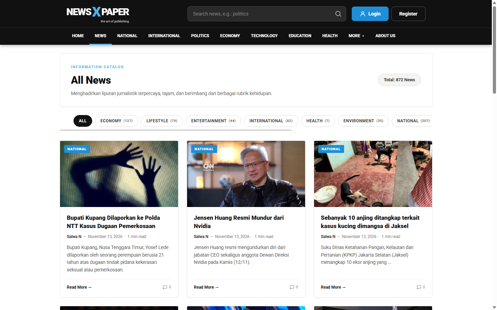

*Caption: Katalog berita lengkap dengan sistem paginasi dinamis (12 artikel per halaman), penunjuk estimasi waktu baca (read time), dan filter sumber berita.*

#### Halaman Detail Berita


*Caption: Halaman baca artikel komprehensif dilengkapi visual gambar berita resolusi tinggi, metadata jurnalis, tanggal publikasi, isi berita, tombol berbagi sosial media, serta forum komentar pembaca.*

#### Halaman Kategori Berita
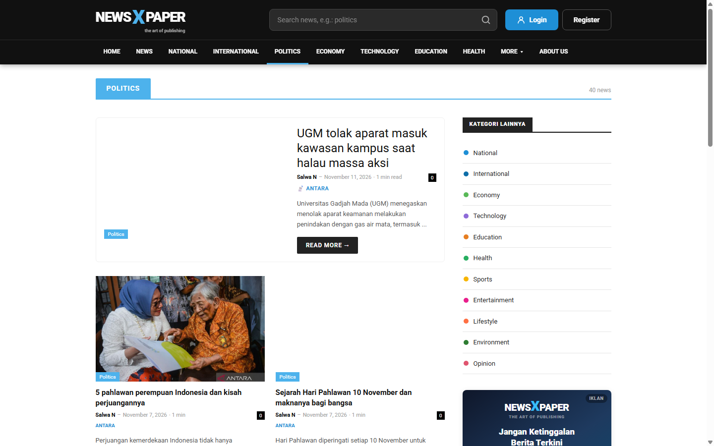

*Caption: Halaman kurasi berita tematik khusus berdasarkan kategori yang dipilih (seperti Politik, Ekonomi, Teknologi, dan Olahraga).*

#### Halaman Pencarian Berita
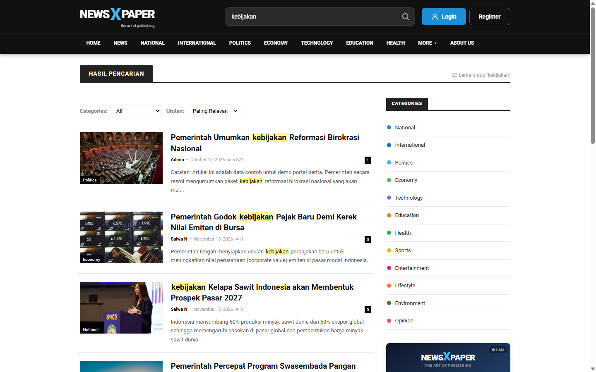

*Caption: Fitur pencarian kata kunci instan dengan proteksi sanitasi XSS yang menyajikan hasil penelusuran artikel relevan secara real-time.*

---

### Autentikasi

#### Halaman Login
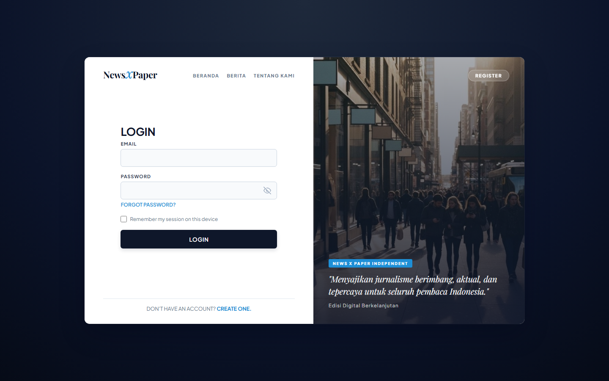

*Caption: Antarmuka masuk bagi pengguna terdaftar dan administrator dengan desain editorial minimalis, tombol lihat password, dan pembatasan frekuensi login (rate limiting).*

#### Halaman Registrasi
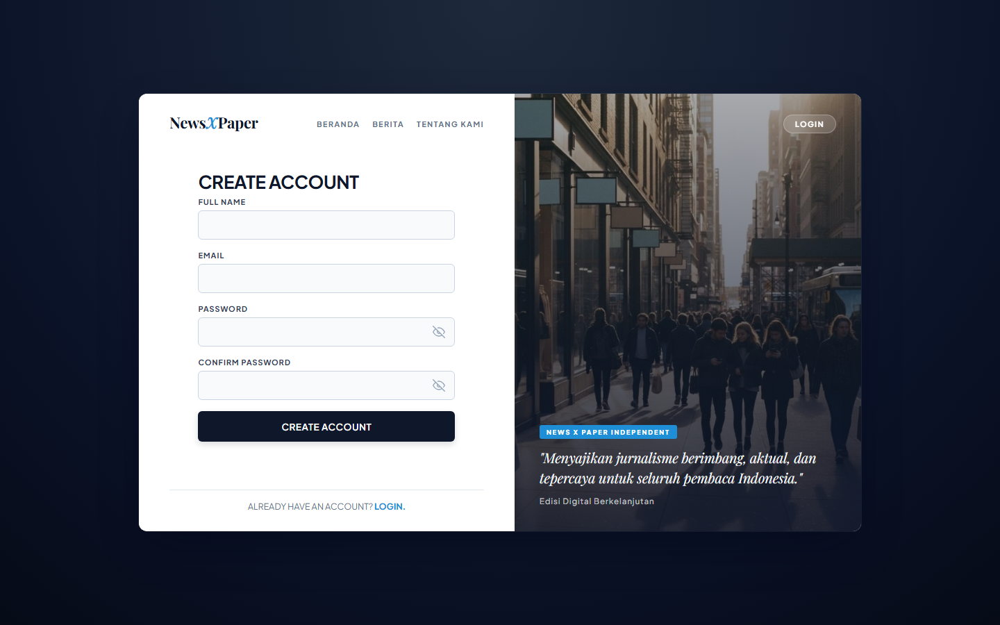

*Caption: Formulir pembuatan akun pembaca baru yang ringkas dengan validasi ketat nama lengkap, format email resmi, dan keamanan kata sandi.*

---

### Dashboard Admin

#### Dashboard Admin
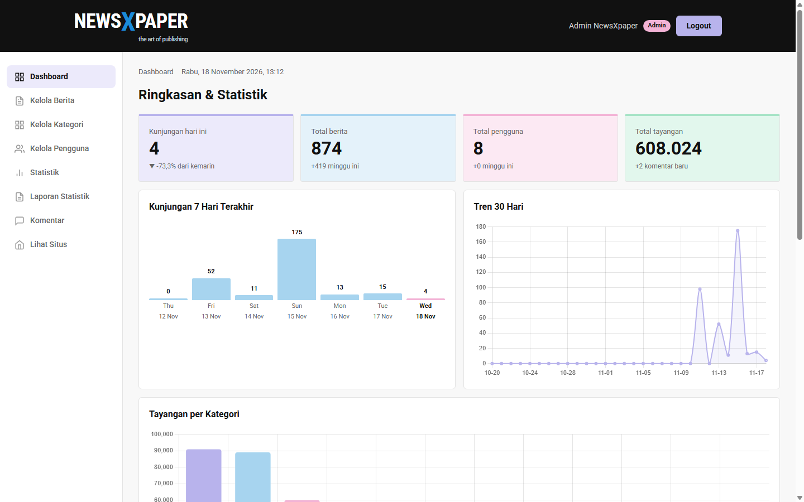

*Caption: Panel monitoring statistik redaksi yang menyajikan metrik total artikel, kategori, pengguna terdaftar, serta grafik analitik tren pembaca interaktif.*

#### Manajemen Berita
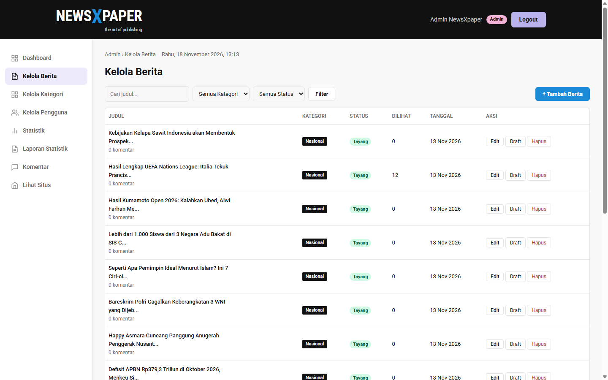

*Caption: Tabel tata kelola konten artikel lengkap dengan pencarian internal, filter kategori, pengalihan status publikasi cepat (Draft / Published), dan aksi CRUD.*

#### Form Tambah Berita
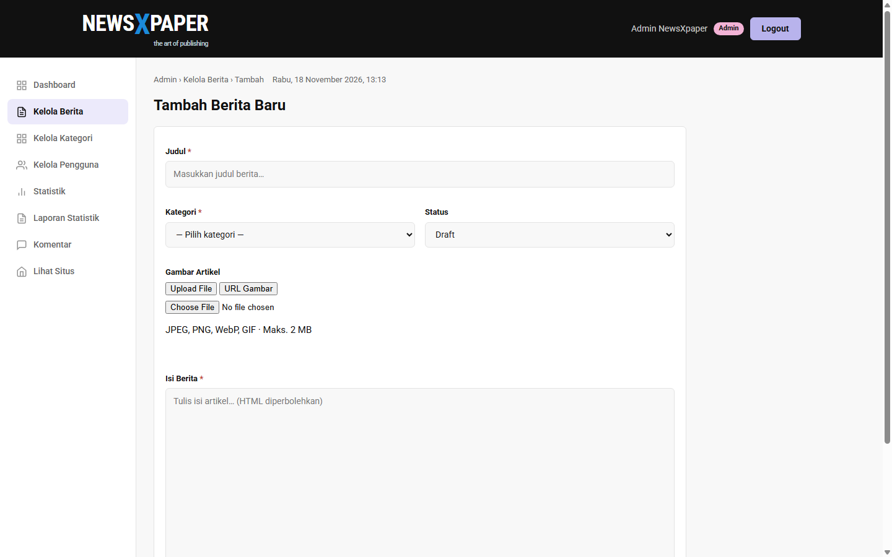

*Caption: Antarmuka publikasi artikel baru yang memudahkan redaksi memilih kategori, mengunggah sampul visual berita, menyematkan sumber, dan menulis konten artikel.*

#### Form Edit Berita
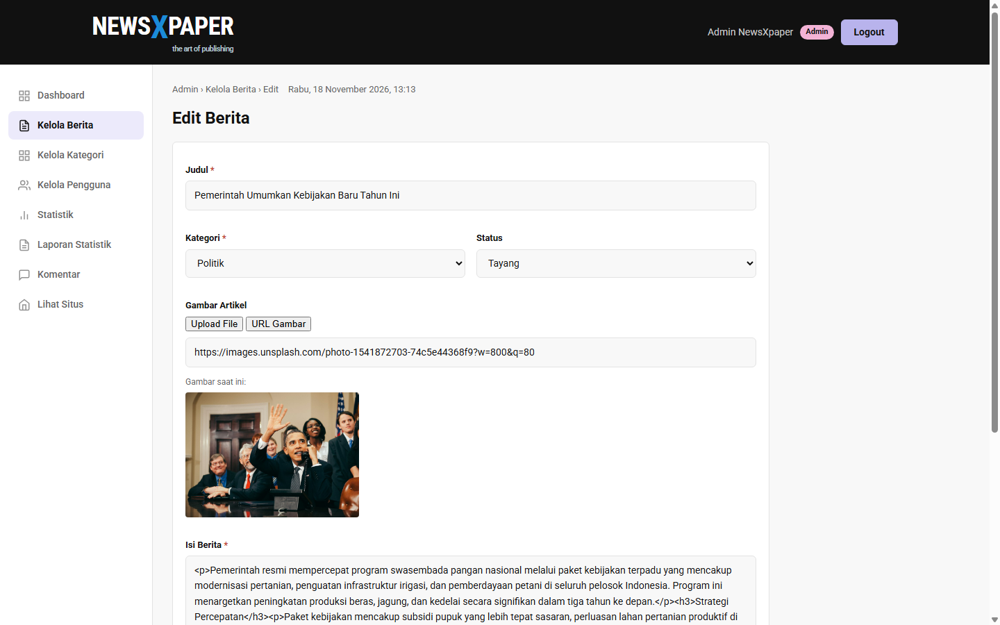

*Caption: Formulir pembaruan data artikel yang memungkinkan administrator mengoreksi judul, memperbarui isi teks berita, atau mengganti gambar ilustrasi artikel.*

#### Manajemen Kategori
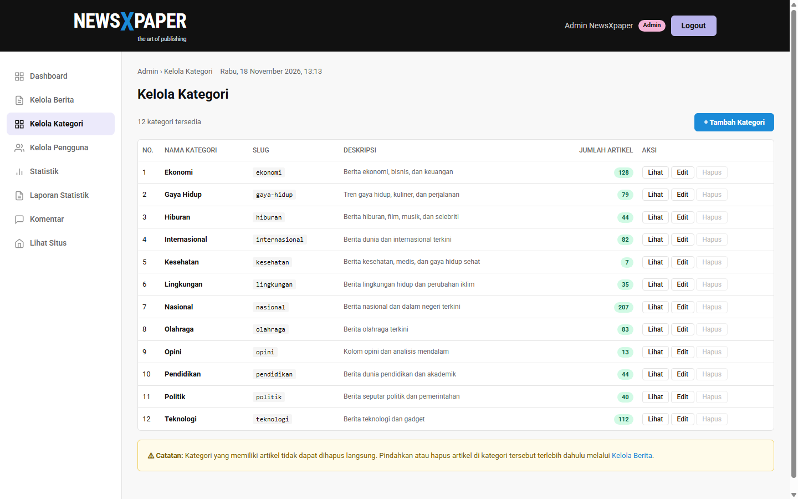

*Caption: Panel kendali kategori berita untuk menambah klasifikasi baru, mengedit slug, serta mengontrol proteksi relasi artikel agar kategori yang memiliki data berita tidak terhapus sengaja.*

#### Manajemen Pengguna
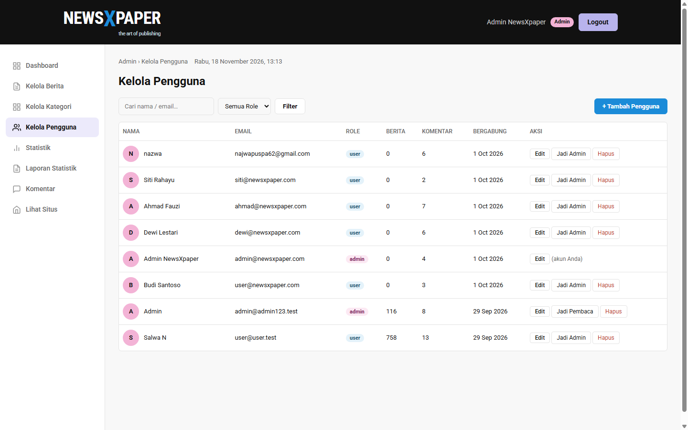

*Caption: Panel kontrol akun pengguna untuk meninjau pembaca terdaftar, menetapkan hak akses wewenang (role Admin / User), dan mengelola akun internal.*

---

### Profil dan Mobile

#### Halaman Profil Pengguna
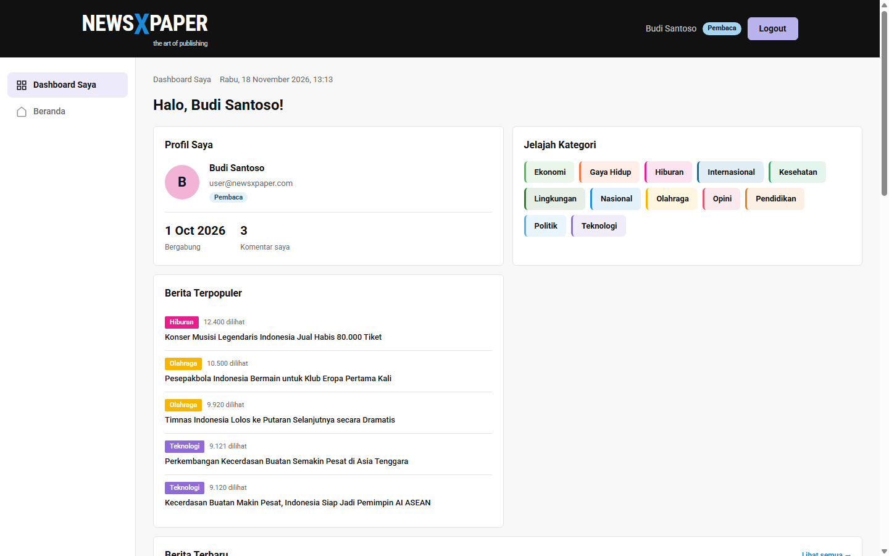

*Caption: Dashboard personal pembaca yang menyajikan informasi identitas pengguna, ringkasan aktivitas membaca, formulir ganti kata sandi, serta riwayat artikel yang disimpan (bookmark).*

#### Tampilan Beranda pada Perangkat Mobile
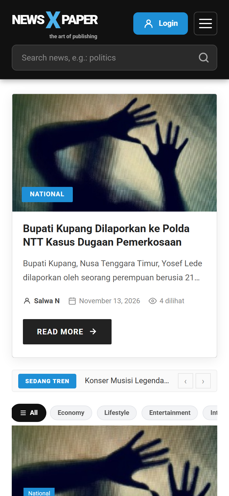

*Caption: Tampilan responsif halaman beranda pada perangkat mobile (resolusi layar smartphone 390px) yang membuktikan keindahan dan keterbacaan layout di layar sentuh ponsel.*

---

## 6. Fitur Utama

### 🌐 Fitur Publik (Pembaca Umum)
- **Desain Editorial Monokrom**: Tampilan terinspirasi dari surat kabar klasik dengan sentuhan tata letak modern.
- **Berita Utama & Running Ticker**: Penyorotan informasi mendesak (*Breaking News*) di baris teratas situs.
- **Pencarian Real-Time**: Pencarian artikel cepat berbasis judul dan konten dengan rekomendasi kata kunci.
- **12 Kategori Berita Tematik**: Pengelompokan informasi yang rapi dan mudah diakses.
- **Estimasi Waktu Membaca**: Kalkulasi otomatis durasi membaca artikel berdasarkan rata-rata kata (*read time calculator*).
- **Interaksi Sosial Media**: Tombol berbagi instan ke WhatsApp, Twitter/X, Facebook, dan salin tautan clipboard.
- **Langganan Buletin (Newsletter)**: Form pendaftaran email pembaca untuk menerima ringkasan berita pilihan.
- **Dukungan Multi-Bahasa**: Tombol penggantian bahasa antarmuka (Bahasa Indonesia & Bahasa Inggris).

### ✍️ Fitur Pembaca Terdaftar (User Role)
- **Autentikasi Aman**: Login, Registrasi, Lupa Kata Sandi, dan Reset Password berbasis Token aman.
- **Dashboard Pembaca**: Area personal yang menampilkan rekomendasi berita pilihan.
- **Sistem Komentar**: Kemampuan memberikan ulasan dan berdiskusi pada artikel berita yang dipublikasikan.
- **Bookmark Artikel**: Menyimpan berita favorit ke daftar bacaan pribadi untuk diakses kemudian hari.
- **Pengaturan Akun**: Mengubah nama tampilan dan memperbarui kata sandi secara mandiri.

### ⚙️ Fitur Administrator Redaksi (Admin Role)
- **Ringkasan Analitik Dashboard**: Visualisasi metrik total pembaca, grafik tren artikel harian, dan pembagian porsi kategori.
- **Manajemen Artikel Lengkap (CRUD)**: Pembuatan, peninjauan, pengeditan, penghapusan, dan pengalihan status cepat (*Publish / Draft*).
- **Proteksi Kategori Berita**: Sistem validasi terintegrasi yang mencegah penghapusan kategori jika masih memiliki artikel aktif.
- **Kelola Akun & Penugasan Role**: Pengelolaan data pengguna beserta hak akses administratif.
- **Moderasi Komentar**: Pengawasan dan penghapusan komentar yang mengandung unsur spam atau pelecehan.
- **Ekspor Dokumen Resmi**:
  - **Ekspor PDF (A4)**: Menghasilkan berkas PDF siap cetak dengan format tabel resmi dan kop identitas NewsXPaper.
  - **Ekspor Excel (.xlsx)**: Menghasilkan lembar kerja multi-sheet yang memisahkan ringkasan metrik, performa kategori, kontribusi jurnalis, dan seluruh rincian artikel.
- **Agregator RSS Otomatis**: Integrasi penjadwal berkala (*scheduler*) untuk menyerap ratusan berita baru dari media partner terkemuka.

---

## 7. Teknologi yang Digunakan

| Kategori | Teknologi / Pustaka | Versi | Fungsi / Kegunaan |
| :--- | :--- | :--- | :--- |
| **Backend Framework** | Laravel | `13.33.0` | Kerangka kerja aplikasi utama, routing, ORM, & controller |
| **Bahasa Pemrograman** | PHP | `^8.3` / `8.5` | Bahasa runtime backend berorientasi objek modern |
| **Basis Data** | MySQL / MariaDB | `5.7+` / `10.4+` | Penyimpanan relasional artikel, kategori, user, & komentar |
| **Frontend Styling** | Tailwind CSS & Custom CSS | `4.0.0` | Framework utilitas CSS modern untuk desain editorial |
| **Asset Bundler** | Vite | `^8.0.0` | Kompilasi kilat aset CSS, JS, dan integrasi modul frontend |
| **Visualisasi Data** | Chart.js | `4.4.x` | Grafik analitik interaktif pada dashboard admin |
| **Generator Dokumen PDF** | `barryvdh/laravel-dompdf` | `^3.1` | Pembuatan laporan cetak format PDF ukuran A4 |
| **Generator Spreadsheet**| `phpoffice/phpspreadsheet` | `^5.11` | Kompilasi laporan multi-sheet format Microsoft Excel |
| **Deteksi Perangkat** | `laravel/agent-detector` | `2.0.2` | Pengenalan agen peramban untuk optimasi rendering mobile |
| **Pengujian (Testing)** | PHPUnit | `^12.5` | Kerangka pengujian fitur, validasi, dan keamanan |

---

## 8. Arsitektur Project

Aplikasi NewsXPaper mengadopsi standar **Model-View-Controller (MVC)** yang diperkaya dengan lapisan layanan (*Service Layer*) dan pengaman (*Middleware*):

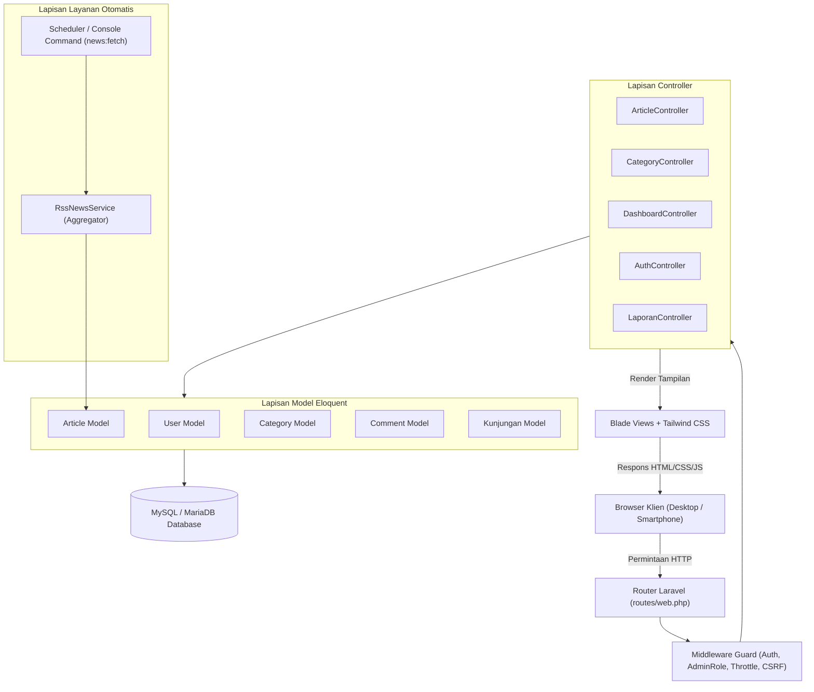

---

## 9. Persyaratan Instalasi

Pastikan komputer atau server telah terpasang perangkat lunak berikut sebelum memulai proses instalasi:

- **PHP**: Versi `8.3.0` atau yang lebih tinggi (mendukung PHP `8.4` dan `8.5`).
  - *Ekstensi PHP Wajib*: `BCMath`, `Ctype`, `cURL`, `DOM`, `Fileinfo`, `Filter`, `GD`, `Hash`, `Mbstring`, `OpenSSL`, `PCRE`, `PDO`, `pdo_mysql`, `Session`, `Tokenizer`, `XML`, `Zip`.
- **Composer**: Versi `2.2` atau yang lebih baru.
- **Node.js & NPM**: Node.js `20.x` LTS atau lebih baru.
- **MySQL Server**: Versi `5.7` / `8.0` atau **MariaDB** `10.4` ke atas.
- **Git CLI**: Untuk mengkloning kode sumber.
- **Web Server**: Apache (`mod_rewrite` aktif), Nginx, atau Laragon.

---

## 10. Panduan Instalasi

Ikuti langkah-langkah instalasi standar berikut untuk menjalankan project di komputer lokal:

### 1. Kloning Repository
Buka terminal atau command prompt, lalu jalankan perintah:
```bash
git clone https://github.com/najwapuspa/portal-berita.git
cd portal-berita
```

### 2. Instalasi Dependensi Backend (Composer)
Unduh seluruh library dependensi PHP Laravel:
```bash
composer install
```

### 3. Konfigurasi File Environment
Salin berkas contoh konfigurasi ke berkas `.env` aktif:
```bash
# Untuk Windows (Command Prompt / PowerShell)
copy .env.example .env

# Untuk Linux / macOS
cp .env.example .env
```

### 4. Pembuatan Kunci Aplikasi (Application Key)
Generate enkripsi unik aplikasi Laravel:
```bash
php artisan key:generate
```

### 5. Konfigurasi Basis Data
Buka file `.env` menggunakan editor teks (seperti VS Code atau Notepad), kemudian sesuaikan pengaturan koneksi database Anda:
```env
DB_CONNECTION=mysql
DB_HOST=127.0.0.1
DB_PORT=3306
DB_DATABASE=portal_berita
DB_USERNAME=root
DB_PASSWORD=
```
> Pastikan database dengan nama `portal_berita` telah dibuat di MySQL melalui phpMyAdmin, MySQL Workbench, atau terminal MySQL.

### 6. Eksekusi Migrasi & Seeder Database
Siapkan struktur tabel basis data beserta data awal kategori, akun demo, dan berita:
```bash
php artisan migrate --seed
```

### 7. Buat Symbolic Link Direktori Storage
Hubungkan folder penyimpanan file unggahan publik agar gambar dapat diakses oleh browser:
```bash
php artisan storage:link
```

### 8. Instalasi Dependensi Frontend & Kompilasi Aset
Pasang paket frontend dan lakukan proses build aset menggunakan Vite:
```bash
npm install
npm run build
```

### 9. Jalankan Server Pengembangan
Nyalakan server bawaan Laravel:
```bash
php artisan serve
```
Buka peramban favorit Anda dan kunjungi tautan: **`http://localhost:8000`**

---

## 11. Konfigurasi Environment

Berikut adalah referensi format berkas `.env` yang aman digunakan untuk lingkungan lokal maupun server produksi:

```env
APP_NAME="NEWS X PAPER"
APP_ENV=local
APP_KEY=base64:GENERATE_KEY_DENGAN_ARTISAN_KEY_GENERATE
APP_DEBUG=true
APP_TIMEZONE="Asia/Jakarta"
APP_URL=http://localhost:8000

APP_LOCALE=id
APP_FALLBACK_LOCALE=id
APP_FAKER_LOCALE=id_ID

LOG_CHANNEL=stack
LOG_STACK=single
LOG_DEPRECATIONS_CHANNEL=null
LOG_LEVEL=debug

DB_CONNECTION=mysql
DB_HOST=127.0.0.1
DB_PORT=3306
DB_DATABASE=portal_berita
DB_USERNAME=root
DB_PASSWORD=

SESSION_DRIVER=database
SESSION_LIFETIME=120
SESSION_ENCRYPT=false
SESSION_PATH=/
SESSION_DOMAIN=null

CACHE_STORE=database
QUEUE_CONNECTION=database

VITE_APP_NAME="${APP_NAME}"
```

> ⚠️ **Catatan Keamanan**: Jangan pernah mempublikasikan nilai `APP_KEY`, kata sandi database, atau token rahasia ke repository publik. Seluruh kredensial sensitif telah diabaikan melalui file `.gitignore`.

---

## 12. Konfigurasi Database

### Struktur Tabel Utama:
1. **`users`**: Menyimpan kredensial otentikasi akun, nama lengkap, email unik, dan kolom `role` (`admin` / `user`).
2. **`categories`**: Menyimpan 12 kategori berita resmi dengan kolom `name`, `slug`, dan deskripsi.
3. **`articles`**: Tabel inti artikel yang menyimpan judul, slug SEO, konten teks, ringkasan (*excerpt*), estimasi waktu baca (*read_time*), metadata sumber berita (`source_name`, `source_url`), foto sampul, status (`draft` / `published`), serta jumlah pembaca (`views`).
4. **`comments`**: Memuat relasi komentar pembaca terhadap artikel tertentu dengan relasi ke `user_id` dan `article_id`.
5. **`kunjungan`**: Merekam statistik hit lalu lintas harian untuk komputasi grafik analitik.
6. **`article_bookmarks`**: Menyimpan daftar penanda artikel favorit yang disimpan oleh pembaca terdaftar.
7. **`newsletter_subscribers`**: Daftar alamat email pembaca yang berlangganan warta berita berkala.
8. **`sessions`**, **`cache`**, **`jobs`**: Tabel pendukung sistem internal Laravel untuk performa tinggi.

---

## 13. Struktur Folder Project

Berikut gambaran struktur direktori penting dalam repository NewsXPaper:

```
portal-berita/
├── app/
│   ├── Http/
│   │   ├── Controllers/          # Pengendali alur logika (Article, Auth, Category, Dashboard, Laporan, dll)
│   │   └── Middleware/           # Lapisan otentikasi, otorisasi peran admin, dan proteksi
│   ├── Models/                   # Model Eloquent ORM (Article, Category, User, Comment, Kunjungan)
│   ├── Providers/                # Service provider aplikasi (AppServiceProvider untuk panjang string MySQL)
│   └── Services/
│       └── RssNewsService.php    # Logika cerdas pengambil feed RSS dan deduplikasi artikel
├── bootstrap/
│   └── app.php                   # Inisialisasi kernel HTTP & konfigurasi middleware routing
├── config/                       # Konfigurasi sistem (app, database, cache, categories, session)
├── database/
│   ├── factories/                # Factory generator data acak untuk testing
│   ├── migrations/               # Skrip migrasi skema 15 tabel database
│   └── seeders/                  # Seeder data bawaan (kategori resmi, akun admin & pembaca)
├── docs/
│   ├── ERD.mmd                   # Diagram Entity-Relationship Database (Mermaid format)
│   ├── HOSTING-GUIDE.md          # Petunjuk deployment ke platform hosting
│   └── screenshots/              # 15 berkas visual screenshot asli dokumentasi
├── public/
│   ├── build/                    # Berkas aset terkompilasi Vite (manifest.json, CSS & JS)
│   ├── css/                      # Stylesheet editorial (newspaper.css, dashboard.css)
│   ├── storage/                  # Symlink berkas gambar artikel publik
│   ├── .htaccess                 # Konfigurasi rewrite engine Apache & kompresi gzip
│   └── index.php                 # Titik masuk utama eksekusi web publik
├── resources/
│   ├── css/                      # File CSS mentah Tailwind
│   ├── js/                       # Skrip JavaScript interaktif
│   └── views/                    # Berkas template Blade (layouts, articles, admin, auth, partials)
├── routes/
│   ├── web.php                   # Rute halaman publik, autentikasi, pembaca, dan dashboard admin
│   └── console.php               # Konfigurasi jadwal scheduler berkala (news:fetch)
├── storage/                      # Tempat penyimpanan berkas cache, log, dan unggahan gambar
├── tests/                        # Pengujian otomatis Feature & Unit (PHPUnit)
├── .env.example                  # Template aman konfigurasi variabel lingkungan
├── composer.json                 # Konfigurasi paket dependensi PHP backend
├── package.json                  # Konfigurasi dependensi JavaScript frontend
└── vite.config.js                # Konfigurasi bundler Vite
```

---

## 14. Hak Akses Pengguna

Aplikasi membagi kewenangan pengguna menjadi 3 tingkatan yang terisolasi dengan aman:

| Fitur / Halaman | Tamu (Guest) | Pembaca (User) | Administrator (Admin) |
| :--- | :---: | :---: | :---: |
| Membaca Berita & Kategori | ✅ | ✅ | ✅ |
| Melakukan Pencarian Berita | ✅ | ✅ | ✅ |
| Berlangganan Newsletter | ✅ | ✅ | ✅ |
| Berbagi Berita ke Medsos | ✅ | ✅ | ✅ |
| Mengirimkan Komentar | ❌ | ✅ | ✅ |
| Menyimpan Bookmark Berita | ❌ | ✅ | ✅ |
| Mengakses Dashboard Pembaca | ❌ | ✅ | ✅ |
| Akses Panel Dashboard Admin | ❌ | ❌ | ✅ |
| Tambah / Edit / Hapus Berita | ❌ | ❌ | ✅ |
| Manajemen Kategori Berita | ❌ | ❌ | ✅ |
| Manajemen Akun Pengguna | ❌ | ❌ | ✅ |
| Moderasi & Hapus Komentar | ❌ | ❌ | ✅ |
| Ekspor Laporan (PDF & Excel) | ❌ | ❌ | ✅ |

---

## 15. Informasi Keamanan

Sistem NewsXPaper dirancang dengan mengutamakan standar keamanan web modern OWASP:

1. **Proteksi Cross-Site Request Forgery (CSRF)**: Seluruh formulir pengiriman data POST, PUT, dan DELETE dilindungi token CSRF otomatis dari Laravel.
2. **Mitigasi Cross-Site Scripting (XSS)**: Seluruh input pencarian, parameter query, dan data yang dirender pada Blade dibersihkan menggunakan pembersihan karakter khusus `e()` / `htmlspecialchars`.
3. **Pencegahan SQL Injection**: Penggunaan Laravel Eloquent ORM dengan *PDO Parameter Binding* menjamin parameter query tidak dapat dimanipulasi oleh injeksi SQL.
4. **Enkripsi Kata Sandi (Password Hashing)**: Kata sandi pengguna diamankan dengan algoritma mutakhir Bcrypt dengan faktor biaya kerja (*work factor*) standar industri.
5. **Rate Limiting & Anti Brute-Force**: Rute autentikasi login dibatasi menggunakan middleware pembatas frekuensi `throttle:5,1` (maksimal 5 percobaan per menit per alamat IP).
6. **Verifikasi Otorisasi Middleware**: Akses ke seluruh rute `/admin/*` diverifikasi ganda melalui middleware autentikasi dan pengecekan role `admin`.

---

## 16. Informasi Deployment

Aplikasi NewsXPaper dirancang fleksibel untuk di-deploy ke berbagai jenis infrastruktur server:

### A. Shared Hosting (cPanel / DirectAdmin)
- Konfigurasi root direktori web server diarahkan ke folder `public/`.
- Gunakan rute fallback `/storage/{path}` yang tersedia di `routes/web.php` apabila server hosting tidak menyediakan akses terminal SSH untuk perintah `php artisan storage:link`.
- Pastikan versi PHP pada cPanel telah diatur ke PHP 8.3 atau yang lebih baru.

### B. Platform Cloud Modern (Railway / VPS)
- Disarankan menggunakan Dockerfile resmi berbasis PHP 8.3 FPM + Nginx.
- Pastikan variabel `PORT` dipetakan dengan benar.
- Jalankan perintah caching produksi:
  ```bash
  php artisan config:cache
  php artisan route:cache
  php artisan view:cache
  ```

---

## 17. Panduan Mengatasi Masalah

### 1. Pesan `403 Forbidden` Saat Mengakses Halaman
- **Penyebab**: Web server (seperti Apache/Nginx) mencoba mengakses root folder project yang tidak memiliki `index.php` atau `DocumentRoot` belum mengarah ke folder `public/`.
- **Solusi**: Pastikan `DocumentRoot` web server mengarah ke folder `/public`, atau gunakan file jembatan `.htaccess` dan `index.php` di root direktori yang telah disediakan.

### 2. Gambar Artikel Tidak Tampil (Broken Image)
- **Penyebab**: Symbolic link direktori storage belum terbentuk atau tidak didukung pada server hosting.
- **Solusi**: Jalankan `php artisan storage:link` pada terminal. Jika di hosting tanpa SSH, NewsXPaper telah dilengkapi rute fallback otomatis melalui controller untuk melayani file dari direktori penyimpanan publik.

### 3. Masalah Panjang Kunci MySQL (`Specified key was too long; max key length is 767 bytes`)
- **Penyebab**: Versi MySQL lama (di bawah 5.7.7) memiliki batas panjang indeks string pada format UTF8MB4.
- **Solusi**: Pada `app/Providers/AppServiceProvider.php`, telah disematkan `Schema::defaultStringLength(191)` di method `boot()` untuk memastikan kompatibilitas penuh.

### 4. Tampilan Rusak / Aset CSS Tidak Termuat
- **Penyebab**: Aset frontend belum dikompilasi oleh Vite.
- **Solusi**: Jalankan perintah `npm install && npm run build` untuk mengompilasi bundel akhir ke direktori `public/build/`.

---

## 18. Pengembangan Selanjutnya

Rencana pembaruan dan peningkatan fitur pada versi mendatang:
- [ ] Penambahan fitur mode gelap (*Dark Mode Toggle*) untuk kenyamanan membaca di malam hari.
- [ ] Sistem notifikasi Web Push berbasis Service Worker saat berita terhangat dipublikasikan.
- [ ] Integrasi kecerdasan buatan (AI) untuk pembuatan ringkasan artikel otomatis (*Auto Summarizer*).
- [ ] Penyediaan antarmuka REST API publik / mobile SDK untuk integrasi aplikasi Android & iOS.
- [ ] Sistem analitik mendalam dengan integrasi Google Analytics 4 dan heatmaps interaktif.

---

## 19. Lisensi

Project **NEWS X PAPER** dikembangkan di bawah lisensi terbuka [MIT License](LICENSE). Anda diperkenankan menggunakan, memodifikasi, dan mendistribusikan kode sumber ini dengan tetap menyertakan atribusi pengembang asli.

---

## 20. Kredit dan Pengembang

- **Pengembang Utama**: [Najwa Puspa](https://github.com/najwapuspa)
- **Framework & Komunitas**: [Laravel Framework](https://laravel.com), [Tailwind CSS](https://tailwindcss.com), [Chart.js](https://www.chartjs.org)
- **Sumber Agregasi Berita**: CNN Indonesia, ANTARA News, Republika, CNBC Indonesia, Tempo, Sindonews.

---

<p align="center">
  Dibuat dengan dedikasi untuk menyajikan informasi terbaik bagi Indonesia.<br>
  © 2026 <strong>NEWS X PAPER</strong>. All rights reserved.
</p>
